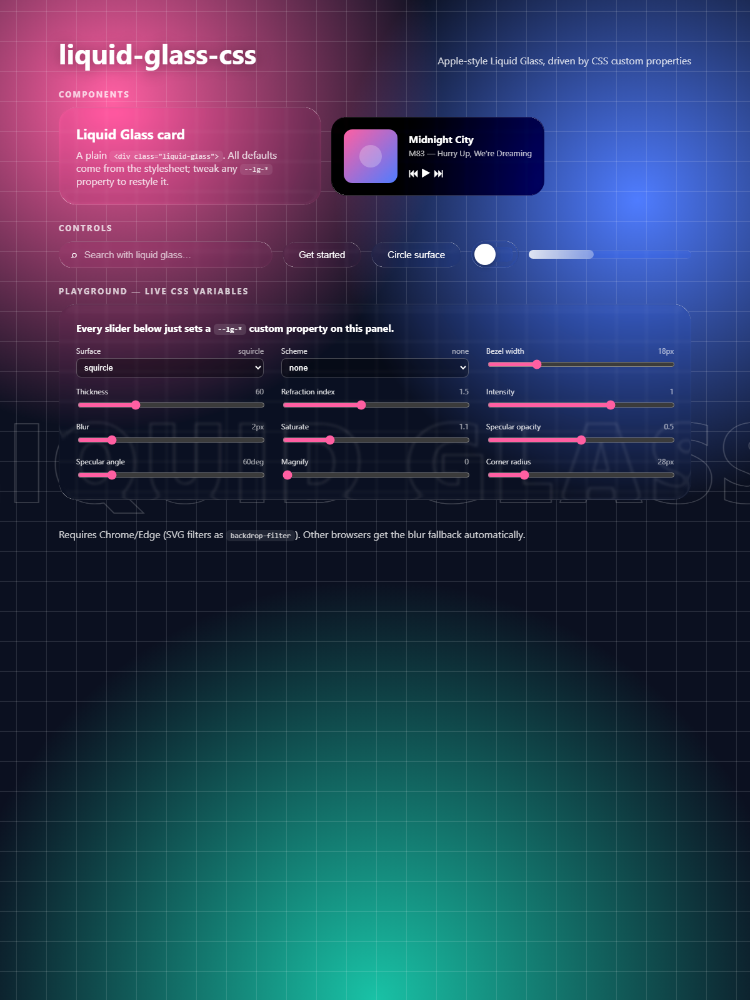

# liquid-glass-css

Apple-style **Liquid Glass** for any HTML element — real physics-based refraction plus a specular rim highlight — driven entirely by **CSS custom properties**.

Based on the approach described in Chris Feijoo's excellent article
[“Liquid Glass in the Browser: Refraction with CSS and SVG”](https://kube.io/blog/liquid-glass-css-svg/): rays are traced through a virtual glass surface with Snell's law, baked into an SVG displacement map, and applied as a `backdrop-filter`.

```css
.card {
  --lg-surface: squircle;   /* glass profile            */
  --lg-bezel: 22px;         /* curved ring width        */
  --lg-thickness: 90;       /* refraction amplification */
  --lg-specular: 0.6;       /* rim highlight opacity    */
}
```

```html
<div class="liquid-glass card">Hello, glass.</div>
```



> [!IMPORTANT]
> **Chrome / Edge only** for the full effect: it relies on SVG filters as
> `backdrop-filter`, which no other engine supports yet. Firefox and Safari
> automatically get a layered-blur fallback (`.lg-fallback`).

## Install

```sh
npm install liquid-glass-css
```

or from a CDN:

```html
<link rel="stylesheet" href="https://unpkg.com/liquid-glass-css/css/liquid-glass.css" />
<script type="module" src="https://unpkg.com/liquid-glass-css/dist/auto.js"></script>
```

## Quick start

**Option A — automatic.** Import the stylesheet and the `auto` entry. Every
`.liquid-glass` (or `[data-liquid-glass]`) element gets the effect and stays
in sync with DOM changes:

```js
import "liquid-glass-css/style.css";
import "liquid-glass-css/auto";
```

**Option B — manual.**

```js
import "liquid-glass-css/style.css";
import { startLiquidGlass, applyLiquidGlass } from "liquid-glass-css";

startLiquidGlass();          // scan + observe the whole document
applyLiquidGlass(element);   // …or apply to one element
```

## CSS API

Set these custom properties on any glass element (inline, in a class, or
globally on `:root`). Changing them at runtime rebuilds the filter
automatically.

| Property | Default | Description |
| --- | --- | --- |
| `--lg-surface` | `squircle` | Bezel profile: `squircle`, `circle`, `concave`, `lip` |
| `--lg-bezel` | `16px` | Width of the curved ring where refraction happens |
| `--lg-thickness` | `60` | Virtual glass depth — amplifies displacement |
| `--lg-ior` | `1.5` | Index of refraction (glass ≈ 1.5) |
| `--lg-intensity` | `1` | Multiplies displacement; animate to fade the effect |
| `--lg-blur` | `2px` | Backdrop blur before refraction (frost) |
| `--lg-saturate` | `1.1` | Saturation boost after refraction |
| `--lg-specular` | `0.5` | Specular rim highlight opacity, `0`–`1` |
| `--lg-specular-angle` | `60deg` | Light direction for the highlight |
| `--lg-specular-width` | `1.2px` | Highlight rim width |
| `--lg-scheme` | `none` | `none` \| `light` \| `dark` brightness compensation |
| `--lg-magnify` | `0` | Magnifying pre-pass scale in px (`0` = off) |
| `--lg-radius` | `border-radius` | Corner radius; must be ≥ `--lg-bezel` |

### Presets

`lg-pill`, `lg-switch` (lip surface), `lg-strong`, `lg-subtle`:

```html
<button class="liquid-glass lg-pill">Get started</button>
```

## JavaScript API

```ts
import {
  startLiquidGlass,     // scan + observe (returns stop fn)
  scanLiquidGlass,      // one-shot scan of a subtree
  applyLiquidGlass,     // apply to one element (optionally with JS overrides)
  refreshLiquidGlass,   // re-read CSS vars and rebuild if changed
  releaseLiquidGlass,   // remove the effect
  supportsLiquidGlass,  // feature detection
  // low-level, DOM-free building blocks:
  computeDisplacementProfile,
  buildDisplacementMap,
  buildSpecularMap,
  buildMagnifyMap,
  createGlassFilter,
  surfaces,
} from "liquid-glass-css";
```

JS overrides win over CSS custom properties:

```ts
applyLiquidGlass(el, { surface: "lip", bezelWidth: 12, specularOpacity: 0.8 });
```

Filters are cached by (options × size × devicePixelRatio), so many elements
with identical configurations share a single SVG filter.

## How it works

1. A **surface function** describes the bezel cross-section height.
2. Rays are refracted through it with **Snell's law** (one half-slice, 128
   samples — symmetry does the rest) → a 1D displacement profile.
3. The profile is rotated around the rounded-rectangle distance field into a
   2D **displacement map** (R = Δx, G = Δy), rasterized at `devicePixelRatio`.
4. An SVG filter chains `feGaussianBlur` → `feDisplacementMap` →
   `feColorMatrix` (saturate) → specular rim highlight, and is applied as
   `backdrop-filter: url(#id)`.

Simplifications (same as the reference article): one refraction event,
orthogonal incident rays, no perspective, no gap between glass and backdrop.

## Performance notes

- Map generation is `O(width × height)` per unique configuration and runs on
  option/size changes — keep animations to `--lg-intensity` (reuses the map,
  only changes `feDisplacementMap scale`).
- Filters are shared between elements with identical config and size.

## Development

```sh
pnpm install
pnpm build   # tsup → dist/ (ESM + CJS + d.ts)
pnpm test    # node:test physics suite
pnpm demo    # http://localhost:8080/demo/
```

## Credits

- [Chris Feijoo — Liquid Glass in the Browser](https://kube.io/blog/liquid-glass-css-svg/)
  for the original exploration this library implements.
- [Snell's law](https://en.wikipedia.org/wiki/Snell%27s_law) ·
  [feDisplacementMap](https://developer.mozilla.org/en-US/docs/Web/SVG/Reference/Element/feDisplacementMap) ·
  [Squircle](https://en.wikipedia.org/wiki/Squircle)

## License

[MIT](./LICENSE)
